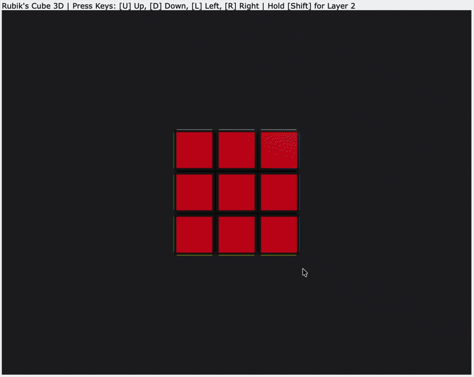

# Rubicks Cube

This is a python simulation of a 3x3 rubicks cube. It is still in the developing phase, and currently shows a 2d layout instead of an actual cube. The logic overall is correct (i guess), and this is still incomplete, it is basically the first version, where you can just play with it, theres no initial scramble or any provision to stop when completely solved, as it currently starts from a solved position.

---

## Cube Defination

---

## Making a Move

---

## Conclusion

Further updates to come, on better visual representation of the cube, and a few logic issues that might arise based on that, this is the first version.

---

# Version-2

So, I upgraded the visuals of the cube to an actual 3d cube, using a python library called vpython, so you can now actually rotate the cube, have a look at it, in 3d from any perspective, and just directly use your keyboard keys to maek the moves. The in-built feature of vpython helps tracking the face colour on the screen in order to execute the moves accordingly on that face colour, thus running behind it the logic of all the changes that will occur in the positions of the colours.

---

## Visuals of the cube

---

## Challenges

Since, the cube can now be rotated in 3d, there is no meaning of the earlier defined functions as up, down, right, left, cause you change teh orientation of the cube and the commands behave completely different then what expected, a better method is to be thought of for that purpose, if we have to go forward with a 3d cube, plus it also gave rise to some logic errors which i noticed when i tested it, although it was a fun project :)
