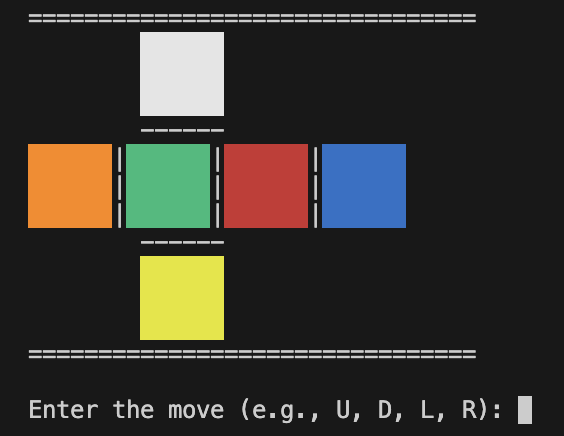
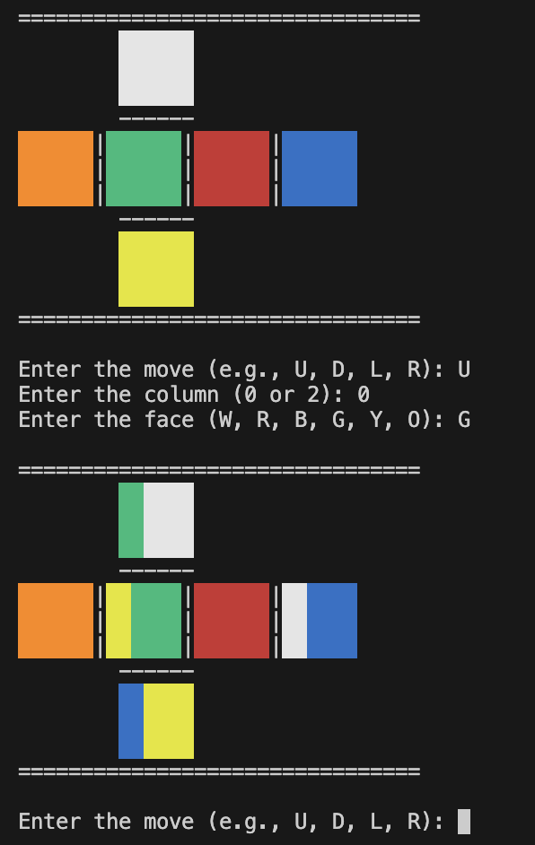

# Rubicks Cube

This is a python simulation of a 3x3 rubicks cube. It is still in the developing phase, and currently shows a 2d layout instead of an actual cube. The logic overall is correct (i guess), and this is still incomplete, it is basically the first version, where you can just play with it, theres no initial scramble or any provision to stop when completely solved, as it currently starts from a solved position.

---

## Cube Defination

---

## Making a Move

---

## Conclusion

Further updates to come, on better visual representation of the cube, and a few logic issues that might arise based on that, this is the first version.